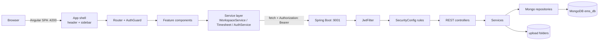
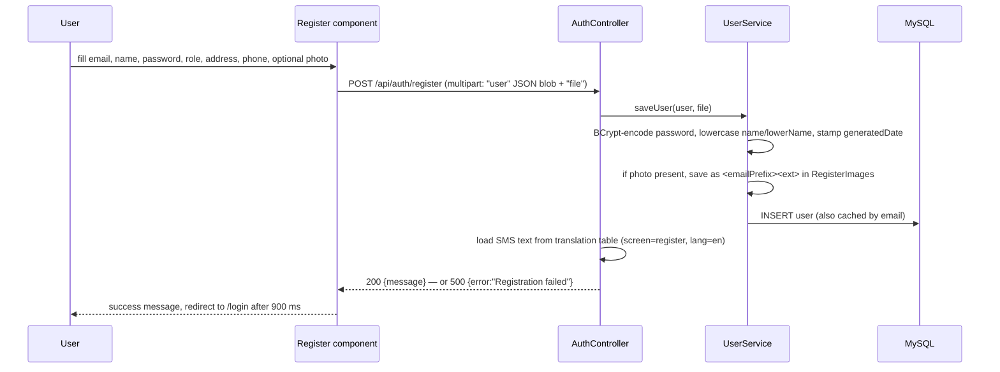
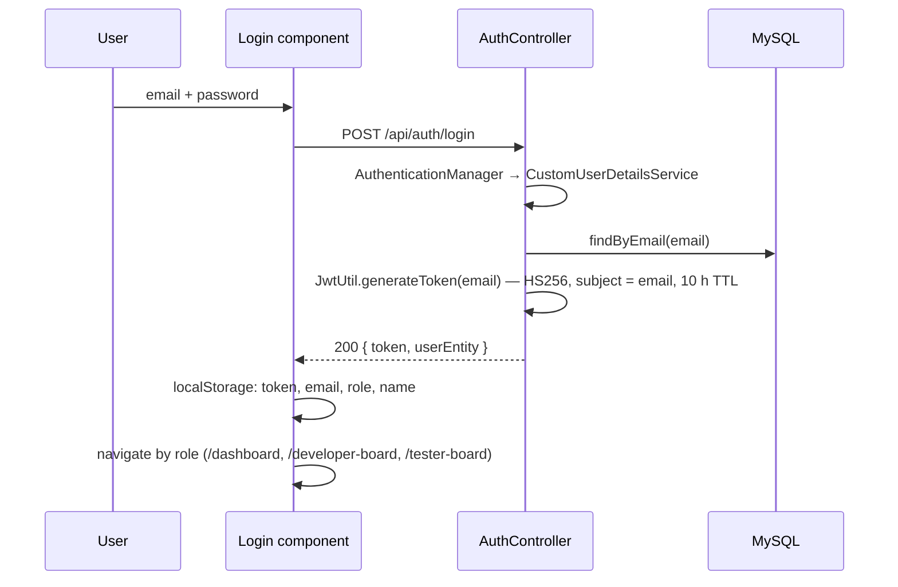
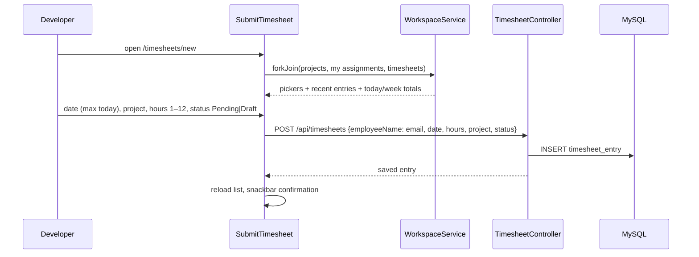
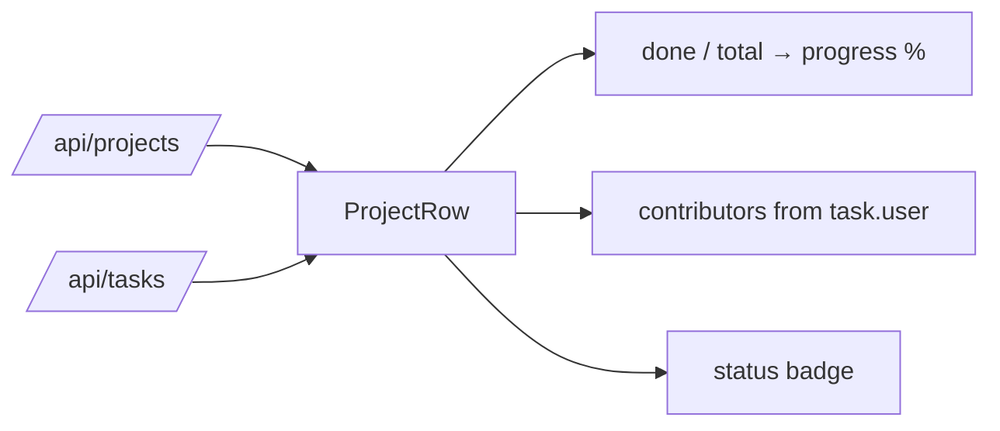
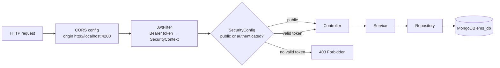
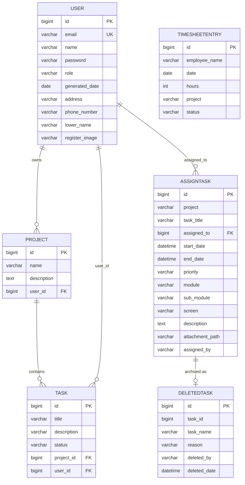
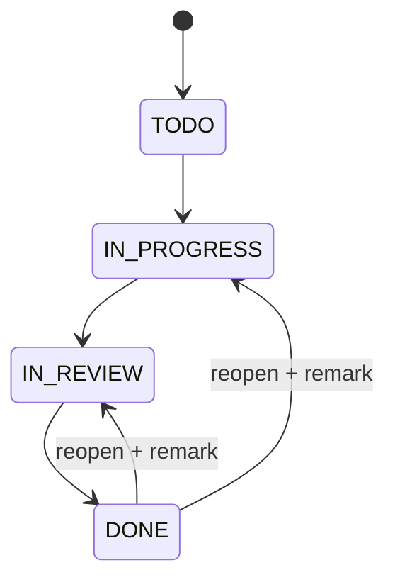
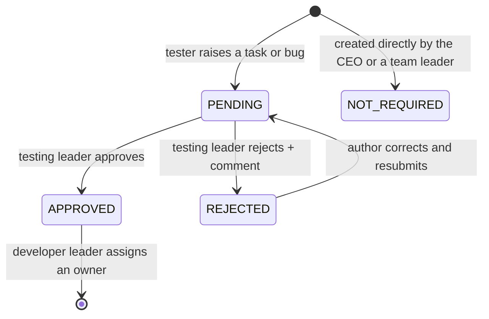

# Employee Management System (EMS) — Detailed Workflow Document

**Version:** 1.0
**Scope:** End-to-end functional and technical workflow of the Angular frontend (`FrontEndCode_EMS-main`) and the Spring Boot backend (`SpringCode_EMS-main`).
**Audience:** Developers, reviewers, and maintainers who need to understand how a user action travels through the system, which tables it touches, and where to change behaviour.

---

## 1. Purpose of the system

The application tracks software delivery work for a small team:

1. An **administrator** registers people and assigns work with a project, owner, priority and deadline.
2. A **developer / tester** sees only their own assignments, reports progress context, and logs the hours they worked against a project.
3. The **workspace dashboards** aggregate the same data into team size, project progress, open work, and logged hours.

---

## 2. System landscape

| Layer | Technology | Location | Runtime |
|---|---|---|---|
| UI | Angular 20, standalone components, Angular Material 20 (dark theme), zone.js change detection | `d:\project-new\FrontEndCode_EMS-main` | `http://localhost:4200` |
| API | Spring Boot 2.4.0, Java 11, Spring Security + JWT (jjwt 0.11.5), Spring Data MongoDB | `d:\project-new\SpringCode_EMS-main` | `http://localhost:9001` |
| Data | MongoDB 9.0, database `ems_db` (collections created on first write) | `mongodb://127.0.0.1:27017` | no auth (local) |
| Files | Upload folders from `application.properties` (images + the self-hosted fonts) | `D:/project-new/uploads/images/` and `D:/project-new/uploads/RegisterImages/` | served via `GET /attachments/**` |

> Note: the Maven artifact and the root Java package are still named `canteenManagment`. That name is historical — the code inside is the EMS domain (users, projects, tasks, timesheets).

---

## 3. High-level architecture



---

## 4. Roles and access

The role is a plain string on `user.role`. Five identities exist, and each one belongs to a *family* — the coarse group the older security rules were written against. `security/Roles.java` is the single source of both, and `models/role.ts` mirrors it on the client.

| Code | Label in UI | Family | Landing page after login |
|---|---|---|---|
| `SUPER_ADMIN` | Super Admin | `ADMIN` | `/dashboard` |
| `TESTER_LEAD` | Tester Team Leader | `TESTER` | `/tester-board` |
| `TESTER` | Tester | `TESTER` | `/tester-board` |
| `DEVELOPER_LEAD` | Developer Team Leader | `EMPLOYEE` | `/developer-board` |
| `EMPLOYEE` | Developer | `EMPLOYEE` | `/developer-board` |

`ADMIN` is the code the CEO carried before this split. Rows that still contain it sign in normally (`Roles.normalise` maps it to `SUPER_ADMIN`), `DataSeeder.migrateLegacyAdminRole()` rewrites them on the next boot, and `GET /api/auth/roles` no longer offers it — so it can never be handed to a new account.

**What each identity can do**

| Capability | `SUPER_ADMIN` | `*_LEAD` | `TESTER` | `EMPLOYEE` |
|---|---|---|---|---|
| Admin Dashboard, Project Overview / create, Registered Employees, View Timesheets, Deleted tasks | ✔ | — | — | — |
| Edit / assign / delete work (`canManageTasks`) | ✔ by role | ✔ by role | only with the task-access provision | — |
| Master data (`canEditMasters`) | ✔ only | — | — | — |
| Own board, My Tasks, My Projects, Submit Timesheet | — | ✔ (a leader is also a member of their team) | ✔ | ✔ |
| Whole register (`/tasks/all`, `GET /api/assigntasks/register`) | ✔ | ✔ | ✔ once granted | — |
| Move work assigned to somebody else (`WorkflowService.requireOwnerOrAdmin`) | ✔ | ✔ | — | — |
| Approve / administer accounts, projects, the deletion audit | ✔ | — | — | — |
| Raise a task or bug (`/issues/new`) | — | testing leader ✔ (skips review); developer leader — | ✔ (PENDING until reviewed) | — |
| Review tester submissions — approve, or reject with a comment (`/approvals`) | ✔ | tester leader ✔ | — | — |
| Hand approved work to a developer (`/triage`) | ✔ | developer leader ✔ | — | — |

Sidebar items and routes follow the same split:

- `SUPER_ADMIN` — Admin Dashboard, Developer Board, Tester Board, Task Board, All Tasks, Development assignment (`/triage`), Testing review (`/approvals`), Master data, Deleted tasks, Project Overview, Create Project, My Projects, Registered Employees, View Timesheets, Update Profile, Settings. No *Raise task / bug* and no *My submissions*: the CEO decides and hands out, it does not file.
- `TESTER_LEAD` — Tester Board, My Tasks, Raise task / bug, My submissions, Testing review, Task Board, All Tasks, My Projects, Submit Timesheet, Update Profile, Settings.
- `DEVELOPER_LEAD` — Developer Board, My Tasks, Development assignment, Task Board, All Tasks, My Projects, Submit Timesheet, Update Profile, Settings (no Raise task / bug or My submissions: the developer side receives work, it never files it).
- `TESTER` — their own board, My Tasks, Raise task / bug, My submissions, My Projects, Submit Timesheet, Update Profile, Settings — **plus** Task Board and All Tasks once an administrator grants the task-access provision.
- `EMPLOYEE` — their own board, My Tasks, My Projects, Submit Timesheet, Update Profile, Settings.

There is no separate *Create Task* screen: every item enters through **Raise task / bug** — filed by the testing team alone — and is given an owner on **Developer task assignment** (§5.17). The CEO reads both decisions but files no work, the development team is on neither raise screen, and the *Raise task / bug* buttons on the Task Board and the All Tasks register are hidden from both of them.

Time is logged by the people who deliver it: `/timesheets/new` is `data.roles: ['DEVELOPER_LEAD','EMPLOYEE','TESTER_LEAD','TESTER']`, the sidebar hides *Submit Timesheet* from the CEO, and `/timesheets` (approval list, `SUPER_ADMIN` only) offers no "Log time" button.

**Task access (a right inside a role).** Editing, assigning and deleting work is a management right held by the CEO and both team leaders; it can also be lent to a single tester. `user.taskManager` holds the provision, `/people/accounts` has a **Task access** column with a *View only → Manage tasks* pill on plain-tester rows (leaders and the CEO read *Full access*), and `PATCH /api/auth/users/{id}/task-access` is the only writer. The flag is read on three levels: `UserService.canManageTasks(authentication)` on the server, `RoleGuard.managesTasks()` for `data.access: 'taskManager'` routes, and `isVisible()` for the sidebar. A developer can never hold it, and revoking it takes effect on the next request because the server re-reads the row — the cached `localStorage.taskManager` only decides what is *shown*.

**Master data (the CEO's own screen).** The vocabulary the task forms pick from — Module → Sub module → Screen — is maintained on `/masters`, which reads and writes `app_master_data`. Curating it is administrative work, so the screen and the two write endpoints belong to the CEO alone: `data.roles: ['SUPER_ADMIN','ADMIN']` on the route, the sidebar entry limited to the same two codes, `SecurityConfig` allowing only `ADMIN`/`SUPER_ADMIN` on `POST` and `DELETE /api/masters`, and `UserService.canEditMasters(authentication)` re-checking it on every write. Reading the lists stays open to every signed-in account, because the raise screen and the edit dialog need them. There is no longer a provision for this: the *Master data* column and the `PATCH /api/auth/users/{id}/master-access` endpoint were retired with it, so a tester or a team leader cannot be lent the vocabulary.

The two work lists are deliberately split: `/tasks` (Task Board) is the cross-team view for the CEO and both team leaders (`data.roles: ['SUPER_ADMIN','ADMIN','DEVELOPER_LEAD','TESTER_LEAD']`), while `/my-tasks` is the member list (`data.roles: ['DEVELOPER_LEAD','EMPLOYEE','TESTER_LEAD','TESTER']`). Neither can open the other's screen by typing the URL — `RoleGuard` bounces them home with a toast. The Task Board reads `GET /api/assigntasks/register` for managers, because `getAssignTask` also feeds the personal dashboards and stays “mine only” for everyone but the CEO. Links that used to point everyone at `/tasks` (the tester board's action, the "View tasks" buttons on `/my-projects`) resolve per role.

**The developer and tester boards.** `/developer-board` and `/tester-board` are the team view of one person's queue, so whoever runs the team reads them: the CEO and both team leaders get a picker built from `GET /api/auth/team-members` and switch the board to one person at a time (`GET /api/assigntasks/getAssignTask?email=…`). A plain `EMPLOYEE` or `TESTER` opens the same component with no picker and only their own assignments — `WorkspaceService.seesTeam()` is the single switch. The roster endpoint returns four fields (id, name, email, role, active) on purpose: `/api/auth/registredEmployees` answers with the raw account entity including its password fields, so it stays CEO-only while a leader reads this one. Membership is by job family, which is also how a leader shows up as a member of their own team: the developer board lists `EMPLOYEE` + `DEVELOPER_LEAD`, the tester board `TESTER` + `TESTER_LEAD`. `getAssignTask` answers for somebody else only when the caller is the CEO (anybody) or a team leader (their own family); every other request falls back to the caller's own rows, so the `email` parameter can never widen a member's view. `GET /api/timesheets` follows the same shape: every row for the CEO, the caller's family for a leader (that is the hours column on the board), own rows otherwise.

**Where the gate lives**

- Sidebar visibility: `src/app/layout/sidebar/sidebar.ts` — `isVisible()` filters each item by its `roles` array.
- Route protection: every non-public route carries `canActivate: [AuthGuard, RoleGuard]`. `AuthGuard` checks that a token exists; `RoleGuard` (`src/app/role-guard.ts`) reads `data.roles` from the route and sends a refused role back to its own home page with a toast.
- Server-side authorisation is enforced in two layers:
  1. `SecurityConfig` — `/api/auth/registredEmployees`, `/api/auth/delete`, `/api/auth/bulk-register`, `/api/auth/roles` and `/api/auth/users/**` (the edit + status + provision endpoints) are `hasRole("ADMIN")`, as are `POST /api/tasks` and `POST /api/projects`; `POST /api/assigntasks/create` with its picker set (`getname`, `getAllProjects`, `getModuleDescription`, `getprocessDescription`, `getcreateDesc`, `totalProjects`) admits `ADMIN`, `SUPER_ADMIN`, `TESTER`, `TESTER_LEAD` and `DEVELOPER_LEAD`, and `POST`/`DELETE /api/masters` are `hasRole("ADMIN")` too. A lead passes the `hasRole("ADMIN")` rules only where they are meant to — `SUPER_ADMIN` also receives `ROLE_ADMIN` as its family authority — and a tester is admitted by role here, then checked for the actual provision in the controller.
  2. Controllers — `AuthContext.isSuperAdmin()` / `isManager()` scope the data (`/api/tasks`, `/api/timesheets`, `/api/assigntasks/getAssignTask`) and pin writes to the caller (`POST /api/timesheets` ignores a spoofed `employeeName`; `PUT /api/UserProfile/update` ignores `email`/`role` for non-CEOs); `/api/assigntasks/register`, `PUT /api/assigntasks/{id}` and deletion go through `UserService.canManageTasks`.
  3. The tester intake chain (§5.17) has explicit rules of its own: `POST /api/workflow/submissions`, `GET /api/workflow/my-submissions` and `PUT /api/workflow/submissions/*` admit `TESTER` and `TESTER_LEAD` — the development team is deliberately absent because it receives approved work instead of filing it, and the CEO is absent because it decides that work instead of filing it; `GET /api/workflow/approvals` and `PATCH /api/workflow/submissions/*/review` are `ADMIN`/`SUPER_ADMIN`/`TESTER_LEAD`; `GET /api/workflow/dev-queue` and `PATCH /api/workflow/submissions/*/assign` are `ADMIN`/`SUPER_ADMIN`/`DEVELOPER_LEAD`. `POST /api/assigntasks/create` keeps its five admitted codes, but the controller now answers a plain tester with `403` and a pointer to the raise screen, so unapproved work cannot enter through the back door.
- Authorities come from `CustomUserDetailsService`, which grants two: `ROLE_<code>` and `ROLE_<family>` (`SUPER_ADMIN` → `ROLE_SUPER_ADMIN` + `ROLE_ADMIN`, `TESTER_LEAD` → `ROLE_TESTER_LEAD` + `ROLE_TESTER`, and so on). `JwtFilter` reloads them on every request, so a role change applies to the next call; `localStorage.role` only decides what the client *shows* until the next sign-in.

### 4.1 Demo logins

The seeded accounts cover the five identities, so every landing page can be tried without editing anything. A **fresh** database gets exactly these rows:

| Role | Email | Password | Lands on | Sees |
|---|---|---|---|---|
| `SUPER_ADMIN` | `admin@ems.com` | `Admin@123` | `/dashboard` | 8 employees, 3 projects, 8 tasks (5 open), all 5 timesheet entries / 34 h, plus account administration |
| `DEVELOPER_LEAD` | `arun@ems.com` | `Employee@123` | `/developer-board` | own board plus the whole register (Task Board, All Tasks) |
| `TESTER_LEAD` | `divya@ems.com` | `Employee@123` | `/tester-board` | own board plus the register |
| `EMPLOYEE` | `developer@ems.com` | `Developer@123` | `/developer-board` | 5 assigned tasks, 5 assignments, own 3 timesheet entries / 21 h |
| `TESTER` | `tester@ems.com` | `Tester@1234` | `/tester-board` | 2 assigned tasks, 2 assignments, own 2 timesheet entries / 13 h |

Four more employee accounts (`karthik@`, `meena@`, `vikram@ems.com`, password `Employee@123`) are seeded so the accounts screen and the assignment pickers have people to show. The lead rows only appear on a **fresh** database; an existing workspace keeps the roles it already had, so the demo team leaders there were put in place through *Registered Employees → Edit account*: `divya@ems.com` is now `TESTER_LEAD` and `karthik@ems.com` is `DEVELOPER_LEAD` (both password `Employee@123`). `arun@ems.com` (shown as *anil*) was a second administrator — `DataSeeder.migrateLegacyAdminRole()` rewrote it from the old `ADMIN` code to `SUPER_ADMIN` on boot. Anybody else is promoted the same way, which is the path an administrator uses in production, and the person picks the new role up at their next call to the server.

Regenerate a password at any time with an admin token:

```bash
curl -X POST http://localhost:9001/api/auth/reset-password \
  -H "Authorization: Bearer $TOKEN" -H 'Content-Type: application/json' \
  -d '{"email":"developer@ems.com","newPassword":"Developer@123"}'
```

---

## 5. End-to-end workflows

### 5.1 Registration



Key behaviours:

- `password` is stored as a BCrypt hash (`$2a$…`), never plain text.
- `name` is kept as the person typed it (`Raju Kumar`); `lowerName` holds the normalised form used for matching.
- `email` is trimmed and lower-cased before saving, and sign-in is case-insensitive (`UserRepository.findByEmailIgnoreCase`), so `Raju@EMS.com` and `raju@ems.com` are the same account.
- Registering an address that already has an account returns `409 {error:"An account with this email already exists"}` instead of creating a second login.
- The photo is **optional** (`@RequestPart(value = "file", required = false)`); when one is uploaded it is renamed deterministically to `<email prefix>.png|jpg`, so re-uploading the same user **overwrites** the previous file.
- Registration sends an SMS only when a phone number is present. The gateway call is capped at 3 s connect / 5 s read and any failure is logged, never returned — the account is already saved at that point.

### 5.2 Login and token lifecycle



`localStorage` contract (every screen depends on these four keys):

| Key | Written by | Read by |
|---|---|---|
| `token` | login | every HTTP call (`Authorization: Bearer …`), `AuthGuard` |
| `email` | login | profile lookup, "my …" filters, task delete audit |
| `role` | login, profile update, header profile sync | sidebar, landing redirect, `isAdmin` checks |
| `name` | login, profile update, header profile sync | greetings, employee name on timesheets |

Token details: signed with a hard-coded secret, 10-hour expiry, validated on each request by `JwtFilter` which loads the user and populates `SecurityContextHolder`. Expiry is not refreshed anywhere — after 10 hours every call returns 403 and the UI keeps showing data from the last successful load until reloaded. A deactivated account is refused at sign-in (`403`, see §5.14) and `JwtFilter` refuses every request that still carries its old token.

### 5.3 Route resolution and shell behaviour

1. `main.ts` → `bootstrapApplication(App, appConfig)`.
2. `appConfig` registers global error listeners, **zone-based change detection**, the router, and `HttpClient`.
3. `App` renders `<app-header>`, `<app-sidebar>` and `<router-outlet>`; it subscribes to router events and hides the shell on `/`, `/login`, `/register`, `/forgotpassward`.
4. `AuthGuard` runs before each protected route; missing token → redirect to `/login`. `RoleGuard` then compares `localStorage.role` with the route's `data.roles`; a refusal shows a toast and returns the role to its own home page.
5. The header resolves the page title from `router.url` via a lookup table, and loads `/api/UserProfile/userdetails` to refresh name/role in the shell.
6. **Nothing is fetched from the internet.** `src/index.html` used to pull Roboto and the Material Icons font from `fonts.googleapis.com`, so a machine with no connection printed every `<mat-icon>` as its ligature name (`space_dashboard`, `account_tree`, `fact_check` …) spelled out in the sidebar. Both links are gone; the shell now loads one local stylesheet, `http://localhost:9001/attachments/ems-fonts.css`, which declares Roboto 300/400/500 and the `Material Icons` family from `uploads/images/fonts/*.woff2` — the same files, served from the app's own folder. The stylesheet and its fonts are ordinary static resources, so adding or replacing them needs no restart; the API must be reachable for the icons to draw.
7. **Quick actions is one card, three lists.** `QuickActions` (`quick-actions/`) reads `localStorage.role` and renders only the shortcuts that role can actually open — CEO (`SUPER_ADMIN` / legacy `ADMIN`): Development assignment, Testing review, Review timesheets, Registered employees, All tasks; `DEVELOPER_LEAD`: Development assignment, Task board, All tasks, My projects, Log hours; `TESTER_LEAD`: Testing review, Raise task / bug, My submissions, All tasks, Log hours. `EMPLOYEE` and `TESTER` get no card at all — their board header already carries the two or three things they own, and a list would just repeat it. The card sits in the column next to the pipeline on `/dashboard`, and under the stat cards of `/developer-board` and `/tester-board` as a full-width tile row (`[wide]="true"` → `.ems-quick--tiles`). Every link mirrors the `data.roles` of its route in `app.routes.ts`, so a shortcut can never lead into a guard's refusal.

### 5.4 Creating work: one door, one number

The administrator's old *Create Task* screen (`/tasks/new`, `create-task/`) has been **retired**. It was the last path that could write an assignment straight onto a developer's board, skipping the approval chain, and two create screens left users picking the wrong one. Work is now created in exactly one place — **Raise task / bug** (`/issues/new`) — and given an owner in exactly one place — **Developer task assignment** (`/triage`). The whole chain is §5.17.

What survives from the old screen, because it is still what the server does:

- `POST /api/assigntasks/create` is still routed and still guarded (`UserService.canManageTasks`), but the UI no longer calls it. It is kept as an API-only entry point, and a plain tester is refused with `403` and a pointer to `/issues/new`.
- Values are still stored in upper case (`project`, `title`, `priority`, `module`, `subModule`, `screen`; the description keeps its case), so a board renders `BUILD THE TASK BOARD CARDS`. This is a backend convention applied to every item, whichever screen created it.
- `module` / `subModule` / `screen` are written as `''` when left blank, and the pickers are the live `app_master_data` tree (§4): a sub module only lists the chosen module's, a screen only the chosen sub module's, and changing a parent clears the picks below it. The raise screen uses the same narrowing pickers and the same 5 MB PDF/DOC/DOCX/PNG/JPG attachment rule.

### 5.5 Developer workflow

1. Login as `EMPLOYEE` → `/developer-board`.
2. The board reads `WorkspaceService.myAssignments()` → `GET /api/assigntasks/getAssignTask` (no email is sent; the backend pins a non-admin caller to their own email). Every row is mapped onto the board's row shape by `boardRows()` — `taskTitle` → `title`, free-text `project` → `{ name }`, `status` defaulted to `TODO`, the owner filled in from `localStorage`, `source: 'assignment'` — so the queue is exactly the work assigned to that developer, the same records `/my-tasks` lists, and a status pill on the board PATCHes `/api/assigntasks/{id}/status` (the Task model is not touched). Hours come from `GET /api/timesheets`, filtered by `myTimesheets` on `employeeName` = stored email **or** stored name.
3. `/my-tasks` reads the same endpoint, so board and list can never disagree.
4. `/my-projects` joins three sources: own assignments, `/api/projects`, and `/api/tasks`, grouping the assignments by project name.
5. `/timesheets/new` logs hours against a project (see §5.6).
6. **The Projects card is a door.** `projectRows` groups `boardTasks` by `project.name` and keeps each group's records, so clicking a row opens `ProjectTasksDialog` (`project-tasks-dialog/`) with that project's work in full: task code, kind, priority, the read-only status pill, title, description, **raised by** and the day it was raised, the module · sub module · screen chain, the date window and the attachment. Nothing extra is fetched — `WorkItemRows.of` already ships `createdByName`, `createdAt`, `priority`, the module chain and `assignedBy` with every row, and `boardRows()` now carries them onto the board's `TaskItem`. Rows that predate the intake have no author, so the popup says *not recorded* and names the leader who handed the work out (`assignedBy`) underneath. **The tester board carries the same card and the same popup** — `TesterDashboardComponent.projectRows` groups its own `boardTasks`, the pill reads `<done>/<total> verified`, and `openProject()` passes `doneLabel: 'verified'` so the popup's subtitle speaks the tester's word instead of *done*. Both boards share `.proj-row` / `.proj-row__chevron` from `styles.css`.
7. **Both boards carry the same Execution progress card.** `/tester-board` reads *Verified / In progress*; `/developer-board` reads *Done / In progress / To do* — finished first, then what is moving, then the backlog — because the developer's lifecycle has that third state. Both share the global `.ems-pipeline` bars and the `ems-actions--stack` foot (`Task board`/`My tasks` + `My projects`) defined once in `styles.css`, so the two dashboards never drift.

**The admin's version of the same boards.** `ADMIN` may open `/developer-board` and `/tester-board`, but there the board starts with a picker instead of a personal queue: `WorkspaceService.isAdmin()` switches the data source to `assignmentsForRole(people, role)` — one `getAssignTask?email=<person>` call per teammate, which an admin is allowed to make — and the flattened rows then feed `teamWork(tasks, timesheets, people, role)`. That keeps only work owned by accounts whose `role` is `EMPLOYEE` (developer board) or `TESTER` (tester board) and returns a `TeamMemberRow` per person — total, to-do, in progress, done, percentage and, on the developer board, hours logged (matched on `employeeName` by email or name, because timesheets store free text). The picker lists every account with those numbers and carries a search box that filters on name or email; a single match is opened automatically, so the detail panels always follow the search (`filteredRows` + `onSearchChange`). Clicking a row (`selectMember`) points `boardTasks` at that person and collapses the picker to a single bar for the chosen employee — name, email, task count, percentage, status and a **Change** button that reopens the searchable list — so no other employee's numbers remain on screen. The stat cards, queue, progress, projects and "latest hours" panels are then exactly that developer's or tester's own board, built from the same assignment records that person sees when they sign in. The first pick defaults to the person with work, else the first account. The admin's own tasks are deliberately absent from both boards; they live on `/tasks` and `/tasks/all`.

**Read-only for the admin.** Those panels are someone else's work, so the admin's copy has no editing controls: both boards bind `[editable]="!isAdmin"` on `app-task-status`, which swaps the transition menu for a static badge — no caret, no status options — that only opens `StatusHistoryDialog`. The developer or tester signing in keeps the full menu on their own board, and administrative status changes stay on `/tasks`, where the admin edits assignments deliberately. The backend rule is unchanged (an admin *may* PATCH any assignment), so this is a UI separation of "reading a person's board" from "managing work", not a permission change.

### 5.6 Timesheet workflow



- `employeeName` stores the **email** of the submitter; the "only mine" filter compares against email or display name.
- `date` is formatted with a local-safe `toIsoDate()` helper so timezone shifts cannot move an entry to the previous day.
- Approval is **not implemented**: `status` is whatever the submitter chooses (`Pending` / `Draft`), and `/timesheets` only displays and filters it. There is no approve/reject endpoint.
- `/timesheets` (admin) lists every entry with search, a "only my entries" toggle and status chips; totals are computed client-side.
- **An admin does not log hours.** The admin only reads other people's entries: *Submit Timesheet* is not in their sidebar, `/timesheets/new` carries `data.roles: ['EMPLOYEE','TESTER']` so typing the URL bounces the admin to `/dashboard` with a toast, and the "Log time" buttons were removed from `/timesheets`. The writer is the person who does the work; the reader is the administrator. To log again as an admin, an account would have to be demoted to `EMPLOYEE` or `TESTER` — there is no per-screen override.

### 5.7 Project tracking and progress maths



- `Task` rows are matched to a `Project` by `task.project.id`, falling back to a case-insensitive **name** match when the relation is absent.
- `progress = round(done / total * 100)`.
- Status rules in `/projects`: no tasks → *Not started*; `done === total` → *Completed*; `progress ≥ 50` → *On track*; otherwise *At risk*.
- Status rules in `/my-projects` add a deadline dimension: `overdue` = tasks whose `endDate` is in the past, `dueSoon` = due within 7 days; any overdue task turns the project *At risk*.

### 5.8 Task deletion (audit-preserving)

`POST /api/assigntasks/delete {taskId, reason, deletedBy}` is exposed from `/tasks/all` (the register) and from `/tasks/deleted`. The Task Board cards carry no delete control — removing an assignment needs a typed reason, so it lives on the register screen instead of next to the status pill.

1. The handler reads the task, copies `taskId`, `taskName` (the description column), `reason`, `deletedBy` and `deletedDate` into the `DeletedTask` table.
2. It then hard-deletes the `AssignTask` row.
3. The UI refreshes the list and shows the server message.

So the *record* survives for audit, but the assignment itself is not recoverable via the API.

**Reading the audit: `/tasks/deleted`.** `DeletedTasks` (`deleted-tasks/*`, sidebar item *Deleted tasks*, `delete_sweep` icon, `data.roles: ['SUPER_ADMIN','ADMIN']`) reads `GET /api/assigntasks/deleted` — every `DeletedTask` sorted by `deletedDate` descending — with four stat cards (removed tasks, removals in the last 7 days, distinct people involved, rows in the current view), a search over task name / reason / `deletedBy` / task number, the reason clamped to two lines with a tooltip for the full text, and the shared `.ems-pager`. The endpoint is `hasRole("ADMIN")` in `SecurityConfig`, so a team leader — even one who may *delete* — receives `403` here; the screen is CEO-only and `RoleGuard` bounces a lead home before it opens.

`deletedBy` is always `AuthContext.email(authentication)` from the JWT; the value in the request body is ignored, so a hand-rolled request cannot pin a deletion on a colleague.

### 5.9 Profile update

1. `/profile` loads `/api/UserProfile/userdetails?username=<email>`.
2. The form sends `PUT /api/UserProfile/update` as multipart:
   - part `details` = JSON `{username, email, fullName, role, address, phoneNumber}`,
   - optional part `profilePhoto`.
3. `UserService.updateUser1` looks the user up **by email**, then updates name/lowerName, role, address, phone and the photo file.
4. On success the component re-syncs `name` and `role` in `localStorage` so the shell immediately reflects the change.
5. Password change is intentionally disabled server-side (the block is commented out in `updateUser1`).

The `fullName`/`phoneNumber` names are mandatory: the DTO is `UserDetailsDTO`, and posting `name`/`phone` is silently ignored (this was the cause of an earlier "save does nothing" defect).

### 5.10 Settings and logout

- `/settings` stores preferences in `localStorage` under `pref.*` (`dailyDigest`, `desktopAlerts`, `weeklySummary`, `autoDraft`, `defaultHours`, `weekStart`). They are UI-only and are not sent to the API. The Appearance card is the second entry point for the theme switch and stores its choice under `theme` (see §5.15).
- Sign out (header menu, settings page) removes `token`, `user`, `email`, `role`, `name` and navigates to `/login`.

### 5.11 Work status lifecycle

Both work models share one lifecycle — `TODO → IN_PROGRESS → IN_REVIEW → DONE` (`UserEntity/WorkStatus`) — and one screen control, `app-task-status`, mounted on `/tasks`, `/my-tasks`, `/developer-board` and `/tester-board`.

| Action | Endpoint | Who |
|---|---|---|
| Move an assignment | `PATCH /api/assigntasks/{id}/status` `{status, note?}` | assignee or admin |
| Move a task | `PATCH /api/tasks/{id}/status` `{status, note?}` | assignee or admin |
| Read the audit trail | `GET /api/assigntasks/{id}/history`, `GET /api/tasks/{id}/history` | assignee or admin |

Rules enforced in `service/WorkflowService`:

- Status parsing is case/space tolerant (`in review` → `IN_REVIEW`); an unknown value returns `400` with the accepted list, a missing row returns `404`, a foreign row returns `403`.
- Repeating the current status is an idempotent no-op and writes **no** history row.
- **Done is terminal.** Moving an item out of `DONE` requires a `note`; without one the API answers `400 "This item is already done. Add a remark explaining why it is moving back."` Moving **to** `DONE` needs no note. The frontend asks first: `app-task-status` opens `StatusRemarkDialog` (`task-status/status-remark-dialog.*`), cancels the move if the box is empty, and sends the trimmed remark as `note`, so it arrives in the audit row.
- Every accepted transition appends a `status_history` row: entity type/id, from → to, actor email and name, optional note (truncated at 500 chars), timestamp.
- **The reason travels with the work.** The moment an item leaves `DONE`, `WorkflowService` also stamps the document itself: `reopenCount` (incremented) and `lastReopenNote` (the same remark). Boards therefore get the rework trail in their normal list call instead of loading a history per card. `AssignTask` and `Task` both carry the fields; rows written before this feature have them null and read as "never reopened".
- The card shows it while the item is open again: an amber `.ems-rework` strip under the description — *Came back from Done (2×) — "…"*. It is hidden once the item is `DONE` again, and appears instantly after a reopen because `app-task-status` emits `(reopened)` alongside `(changed)`. Markup lives in the Task Board card and the My Tasks card.
- **Reaching `DONE` notifies the team leads.** `WorkflowService.notifyIfCompleted()` runs after the history row is written and mails every active `ADMIN` account (`[EMS] Done: <task title>`, see §5.16). It fires on the transition only, so a repeat of `DONE` mails nobody; the recipient list is every active `ADMIN` account, so an administrator who moves a card to `DONE` themselves is on it too.
- Rows written before the lifecycle existed are read as `TODO` and persisted by `DataSeeder.backfillStatuses()` on the next boot.

The Task Board (`/tasks`) renders one section per state — *To do*, *In progress*, *In review*, *Done* — each with its own count, in lifecycle order. Empty sections are hidden, and the priority chips/search filter every section at once. Because the sections are derived from each card's `status`, moving a card with the pill re-files it in place.

Two chip strips sit above the board: **priority** (All / High / Medium / Low) and **state** (All states / To do / In progress / In review / Done). The state strip narrows the board to one section — `statusFilter` is a `STATUS_META` value (or `ALL`) applied inside `filteredTasks`, so it stacks with the priority chip and the search rather than replacing them, and counts are taken over every task so a chip reflects the work that exists behind the current search.

Assignment deletion (`POST /api/assigntasks/delete`) follows the same ownership rule, and `deletedBy` is now taken from the JWT instead of the request body.

### 5.12 Onboarding a team at once

Typing 40 people through the public form is not realistic, so `/people/accounts` has a **Bulk onboard** button that opens `app-bulk-onboard` — paste a spreadsheet block, one person per line:

`name, email, password[, role[, phone[, address]]]` — commas or tabs, an optional header row and `#` comment lines are ignored.

`POST /api/auth/bulk-register {users:[…]}` (ADMIN only, max 200 rows) runs every row independently in `UserService.registerMany` and answers with what happened:

| Field | Meaning |
|---|---|
| `created[]` | id, name, email and role of each account created |
| `skipped[]` | email + reason: invalid email, missing name, password shorter than 6 characters, email already in use |
| `createdCount`, `skippedCount` | counters shown in the dialog summary |

- One duplicate or typo never blocks the rest of the batch; the admin fixes only the listed rows and re-submits those.
- Accepted roles: `EMPLOYEE` (default), `TESTER`, `ADMIN`. `Developer` is accepted as a spelling of `EMPLOYEE` — `UserService.normaliseRole` maps it (and anything unrecognised) to `EMPLOYEE`, which is also the word the UI shows for that role.
- Accounts are usable immediately with the password from the row; people change it from `/profile`.
- Measured: 32 rows in ≈2.4 s end to end (BCrypt hashing dominates).

### 5.13 Capacity for a 40-person team

Measured with 40 accounts (8 seeded + 32 created through the batch endpoint, then removed):

| Call | Result at 40 people |
|---|---|
| `POST /api/auth/bulk-register` (32 rows) | all created, 2.4 s |
| `GET /api/auth/registredEmployees` | 41 rows, 28 ms, sorted by name |
| `GET /api/assigntasks/getname` (assignee picker) | 41 rows, 10 ms |
| `GET /api/tasks` as a new starter | 0 rows, 8 ms (scoped to the caller) |
| `GET /api/assigntasks/getAssignTask` as a new starter | 0 rows, 9 ms |
| `POST /api/assigntasks/create` → assignee opens their board | 201, row visible with status `TODO` |

Nothing in the schema, the auth layer or the id generator is sized for a headcount; the real limits are operational, which is what the current changes address:

- `mongo/MongoIndexInitializer` builds the indexes every scoped query needs at startup (see §8.1), so per-user task, assignment, timesheet and history reads stop scanning whole collections.
- Emails are unique (application check **and** a DB unique index), and login is case-insensitive, so 40 people cannot end up with two accounts each.
- Non-admin reads are still filtered in memory by `TaskController` / `TimesheetController`. That is fine into the low thousands of rows per person; if a workspace ever reaches several hundred people, replace those filters with derived repository queries and paginate the admin boards.

### 5.14 Account administration: role and status

`/people/accounts` is the only screen that changes somebody else's account (`app-registred.employee.list` → `app-edit-employee` dialog).

**Role is a closed list, not free text**

- The dialog's Role dropdown is filled from `GET /api/auth/roles`, which returns `UserService.getRoles()` — the live `app_lookup` `ROLE` codes filtered by `Roles::isAssignable`, i.e. `SUPER_ADMIN`, `DEVELOPER_LEAD`, `EMPLOYEE`, `TESTER_LEAD`, `TESTER` in `sortOrder` order. A new `ROLE` row added to the reference data shows up in the UI without a frontend change; the retired `ADMIN` code is filtered out, so it can never be handed to a new account.
- Every code renders its label from the same lookup (`Super Admin`, `Developer Team Leader`, `Developer`, `Tester Team Leader`, `Tester`) — table badges, role chips, the dialog dropdown, the header identity chip, the profile badge and the board subtitles all go through `src/app/models/role.ts` (`roleLabel`, `roleBadgeClass`), which falls back to a title-cased code so a new value still reads well.
- `PUT /api/auth/users/{id}` rejects anything outside the list with `400 {"error":"Unknown role: SUPERUSER"}`; a legacy `ADMIN` value is accepted and stored as `SUPER_ADMIN`. Changing a person's role clears the task provision unless the new identity is a plain `TESTER`, so a demoted editor never keeps a hidden right.
- Promoting or demoting takes effect on the person's next request, because `JwtFilter` rebuilds authorities from the database each time.

**Active / inactive**

| Action | Where | Effect |
|---|---|---|
| Status pill (Active / Inactive) in the Status column | accounts table | `PATCH /api/auth/users/{id}/status {active}`; list reloads |

- The Status cell is a single button shaped like the role badges: a dot plus *Active* (green) or *Inactive* (red). Both states are the same size and shape — only the colour and the word change — and both read from the same boolean, so the control can never contradict the row. Clicking it flips the account. The Actions column keeps only the edit pencil: the earlier icon buttons (`person_off`/`how_to_reg`, then `block`/`check_circle`) were removed because an action icon cannot also display the current state, and every pair read as the opposite.
- Status is **not** editable from the edit dialog any more. `PUT /api/auth/users/{id}` ignores `active` completely, so a name/role edit can never re-enable a switched-off account. (Worth knowing: `UserEntity` initialises `active` to `TRUE`, so reading the field from a PUT body always looked like an explicit request — a PUT that simply omitted it used to reactivate the account.) Status changes only through the `PATCH` above.

- Stored as `user.active` (Boolean, `true` when the key is missing, so the accounts that predate the field stay active).
- Inactive accounts keep every task, assignment, timesheet and audit row. Only sign-in stops.
- `CustomUserDetailsService` maps `active=false` to a disabled `UserDetails`, so `AuthenticationManager` throws `DisabledException` and `POST /api/auth/login` answers `403 "This account is inactive. Ask an administrator to re-enable it."` — even with the correct password.
- `JwtFilter` checks `isEnabled()` on every request and answers the same `403` JSON, so a token issued before the switch is useless immediately (no waiting for the 10 h expiry).
- Guards: an admin cannot deactivate their own account, and the last active admin cannot be deactivated or demoted (`400` with the reason, shown above the table). The table reloads after a refusal, so the pill snaps back to the state the server actually kept.
- `GET /api/auth/totalEmployees` still counts every record, including inactive ones; the accounts page shows `N active · M inactive` next to the total.
- Inactive rows stay in the table (muted, red *Inactive* pill) and can be filtered with the *Active* / *Inactive* chips, which is what makes re-activating a returning employee possible.

**One people screen, with paging**

- The old `/people` Employee Directory was a card grid over the same `GET /api/auth/registredEmployees` payload, offered the same edit dialog and showed a `designation` that no backend field ever filled. It is gone: `/people` now redirects to `/people/accounts`, the sidebar has a single *Registered Employees* entry, and `employee-directory.component`, `EmployeeService` and the `Employee` interface were deleted.
- The accounts table pages in the browser (`<app-pager>`, 5 / 10 / 25 / 50 per page, **5 by default**) because the whole list already arrives in one 28 ms call at this scale. Search, role chips and status chips filter the complete list first and the page is re-sliced from the result, so a search never hides matches that sit on a later page. Any filter change jumps back to page 1, and a reload clamps the page index if the list shrank.
- If the workspace ever reaches several hundred accounts, move paging (and the filters) into `GET /api/auth/registredEmployees?page=&size=&q=` and return a `Page` — the template already binds `length`/`pageIndex`/`pageSize`, so only the data source changes.
- The same pager drives the `/tasks/all` register (`AllTaskComponent`): 5 rows a page, options 5/10/25/50, search spans the whole list before slicing, a new search term starts at page 1, and a reload clamps the index so deleting the last row of a page cannot leave an empty view. Every record list in the app shares this behaviour - see §5.18.

### 5.15 Dark and light themes

The whole application ships in two themes with one switch. Dark is the default; the choice is per browser.

| Layer | File | Responsibility |
|---|---|---|
| Tokens | `src/styles.css` | `:root` holds the dark values, `html[data-theme="light"]` re-declares the same names with light values |
| Material | `src/styles.css` | `--mat-sys-*` roles are mapped onto the tokens in `html`, and the roles that are not token-derived (on-primary, containers, outline, error) are re-declared for light |
| State | `src/app/services/theme.service.ts` | `ThemeName` signal, `set()`/`toggle()`, writes `localStorage['theme']` and `data-theme` on `<html>` |
| No-flash boot | `src/index.html` | inline script paints the stored theme before Angular boots |
| Entry point | header icon button, Settings → Appearance | moon/sun button in the top bar; two selectable cards with a check on the active one |

Rules for new UI:

- Never write a raw colour in a component stylesheet. Use a token: surfaces `--ems-bg/-surface/-surface-2/-surface-3`, text `--ems-text/-2/-3/-headline`, accents `--ems-primary` + `-soft/-text/-line/-wash`, states `--ems-success|warning|danger|info` (+ `-soft/-line/-text`), and the theme-aware washes `--ems-on-primary`, `--ems-hover-wash`, `--ems-sheen`, `--ems-sheen-soft`, `--ems-grid-line`, `--ems-topbar-bg`, `--ems-sidebar-bg`, `--ems-brand-gradient`, `--ems-gradient-text`, `--ems-glow-a/b`, `--ems-fill-*`, `--ems-scrollbar`.
- Add a new colour in three places: the `:root` value, the `html[data-theme="light"]` value, and the usage site. A token that only exists on `:root` inherits its dark value in light mode.
- The theme object is a signal: read it in templates (`isDark`, `activeTheme`) instead of re-reading `localStorage`.
- `ThemeService` is injected in `App`'s constructor so the attribute is set on every route, including the auth screens where the header (and its toggle) is hidden.
- Inline SVG data URIs (the landing-page `select` arrow) cannot use a `var()`, so they carry a `html[data-theme="light"] .class` override.

### 5.16 Mail notices (assigned → owner, done → team leads)

Two notices carry the workflow off the screen. `service/TaskMailService.java` owns both, and neither is a step of the request that triggers it.

| Event | Triggered from | Sent to | Subject |
|---|---|---|---|
| A task is handed to somebody | `AssignTaskController.createTask` after the save, and `assingTaskService.updateTask` when the owner **changes** | the new owner's `assignedTo.email` | `[EMS] Task assigned: <task title>` |
| Work reaches `DONE` | `WorkflowService.notifyIfCompleted()`, after the `status_history` row is written, for both `AssignTask` and `Task` | every active `ADMIN` account (the team leads) | `[EMS] Done: <task title>` |

**The assignment mail** lists task, project, priority, module, due date and the assignee actor, then links to `ems.app.url + /my-tasks`. It fires on **create** and on an **owner change** during an edit — re-saving a task for the same person does not mail them again (the service compares the previous owner's email with the new one). A tester holding task access sending a task to a developer produces the same notice as an admin doing it, and `assignedBy` is the JWT subject, not a body field.

**The done mail** is raised only on the *transition into* `DONE` (`target == DONE && current != DONE`), so re-saving a card that is already done — an idempotent no-op the lifecycle ignores — sends nothing. The recipients are read at send time from `UserRepository` (`role = ADMIN`, `active != false`), so a new administrator starts receiving them without a restart, and a deactivated one stops. The body names the owner, the actor, the task, the project and the completion date, and links to `/tasks`.

**Mail is an outbox, never a blocker**

- Every send is submitted to one daemon single-thread executor (`ems-task-mail`), so SMTP latency never reaches the request thread — measured `TODO → DONE` and `IN_PROGRESS → DONE` calls stayed at 10–41 ms with mail enabled.
- `mailSender` is `@Autowired(required = false)`: if no `spring.mail.host` exists the bean is absent and the notice is skipped with a warning, never an exception.
- `try/catch(Exception)` around `send()` logs `Could not send "…" to …: <reason>`; a refused message cannot roll back a task that was saved, or fail a status change that already happened.
- With `ems.mail.enabled=false` the full notice (recipients, subject, body) is written to the backend log instead, so the flow can be demonstrated without a mailbox.

**Configuration** (`src/main/resources/application.properties`)

```properties
ems.mail.enabled=true
ems.mail.from=workflow1@iitm.ac.in
ems.app.url=http://localhost:4200
spring.mail.host=smtp2.iitm.ac.in      # pre-existing account, port 465
spring.mail.properties.mail.smtp.connectiontimeout=5000
spring.mail.properties.mail.smtp.timeout=5000
spring.mail.properties.mail.smtp.writetimeout=5000
```

The three timeouts matter more than they look: without them a dead SMTP host can hold the single mail thread for minutes. Note that the seeded demo accounts (`@ems.com`) are not real mailboxes, so a local run logs `Could not send …` for them — the delivery path, not the trigger, is what is missing. Point `ems.mail.enabled=false` for a quiet demo, or edit the addresses to real inboxes to see the messages arrive.

`spring.mail.password` in the committed file is still the placeholder `wpassword`, so `smtp2.iitm.ac.in` refuses every message and the log shows `Could not send … : 535 Authentication failed`. Replace it with the account's real password (or an app password) to make delivery work — the notice content and the trigger need no change.

### 5.17 Tester intake → testing approval → development assignment

The chain has three steps and three owners, and every step edits the **same** `AssignTask` row, so the item keeps one id and one code from the moment it is raised to the moment it is closed.

```mermaid
sequenceDiagram
    participant T as Tester
    participant R as RaiseIssue<br/>/issues/new
    participant WO as WorkflowController<br/>/api/workflow
    participant TL as Testing leader<br/>/approvals
    participant DL as Developer leader<br/>/triage
    participant D as Developer<br/>/my-tasks
    T->>R: kind, project, title, priority, module → screen, description, attachment
    R->>WO: POST /submissions (multipart)
    WO-->>R: 201 + taskCode BUG-00014 (the kind picks the prefix), approvalState PENDING
    WO->>TL: submissionRaised mail (§5.16)
    alt approved
        TL->>WO: PATCH /submissions/{id}/review { APPROVE, note }
        WO->>DL: item appears in GET /dev-queue (approved, unowned)
        DL->>WO: PATCH /submissions/{id}/assign { developerId, priority, dates }
        WO->>D: taskAssigned mail; item appears in getAssignTask
        D->>WO: PATCH /assigntasks/{id}/status → TODO … DONE (§5.11)
    else rejected
        TL->>WO: PATCH /submissions/{id}/review { REJECT, note }
        WO->>T: submissionReviewed mail; comment shown on /my-submissions
        T->>WO: PUT /submissions/{id} (corrections)
        WO->>TL: back to PENDING, re-mailed to the leaders
    end
```

**Step 1 — raise.** `/issues/new` (`raise-issue/`) posts multipart to `POST /api/workflow/submissions`. The row is written with `kind` (`TASK`/`BUG`), the project name, the upper-cased title, the priority as a `PRIORITY` lookup code, the master-data module chain, the description (case kept), an optional attachment in the same `uploads/images` folder the other screens use, `status = TODO`, `createdBy/createdByName/createdAt`, and a default window of today → +7 days. `approvalState` is `PENDING` for a tester and `APPROVED` for the testing team leader, who is an approver of the intake; the item records why in `reviewNote` ("Raised by the testing team leader."). Approving isn't required of an approver. Nobody else reaches this endpoint: the CEO reviews and assigns but raises nothing, and the development team takes only what the intake approved (`canRaise`), which is what keeps every developer-bound item approved before it lands.

**Step 2 — review.** `/approvals` (`approval-queue/`) lists every item with an approval state, pending first, then the decisions already taken. `approve()` is one click; `reject()` demands a comment. `PATCH …/review` accepts `APPROVE`/`APPROVED`/`REJECT`/`REJECTED`, only acts on a `PENDING` row, stamps `reviewedBy` (the reviewer's email), `reviewedAt` and `reviewNote`, and mails the author either way. A rejection is terminal for that attempt: the item is hidden from every queue until the author resubmits.

**Step 3 — assign.** `/triage` (`assignment-queue/`) reads `GET /api/workflow/dev-queue`, which returns `items` (every `APPROVED` row, unowned ones first, then by priority index and id), `developers` (each `EMPLOYEE`-family account with `openTasks` and `active`) and the `awaiting` / `assigned` counts. Picking an item prefills the panel with its priority, so the leader only chooses a person; `PATCH …/assign` requires `APPROVED` and an unowned row, checks that the chosen account is an active member of the development family, then sets `assignedTo`, `assignedBy`, `assignedAt`, an optional priority/date adjustment and an optional note for the developer, and mails the owner with the same `taskAssigned` notice the product already used. From then on the item is ordinary work: it shows on that developer's board, `/my-tasks`, the Task Board, `/tasks/all` and the deletion audit, and moves through the shared status machine (§5.11).

**The Task ID.** `NumericIdCallback` hands every insert a per-collection sequence value that is reconciled with the highest existing `_id` and never reused, so the row id is unique by construction. `assignTaskService.stampCode()` turns it into the item's permanent code once, at creation, and the kind decides the prefix: a task is `TASK-%05d` (`TASK-00042`), a bug is `BUG-%05d` (`BUG-00007`). `AssignTask.codeFor(kind, id)` is the only place that format is built, so the two can never drift apart; the prefix is what lets a reader tell a task from a bug without opening it, and the number is a counter that is never handed out twice, so no two items can share a code. Every later step reads the stored field and nothing renumbers it, so the code a tester quotes at intake is the code the developer closes. Rows written before the split carry the shared `EMS-…` prefix (or none at all): `AssignTask.codeOrGenerated()` derives a missing one from the kind and the id, and `DataSeeder.migrateTaskCodes()` restamps the `EMS-…` rows into the kind-based format at startup - same number, new prefix - so every list shows one scheme. The code appears on the raise screen's confirmation, `My submissions`, `Testing review`, `Development assignment`, the Task Board cards, `My tasks`, the `All tasks` register (its own **Task ID** column, searchable) and the deletion audit, which now archives the code and kind with the row so a removed `BUG-00014` still reads that way.

**Screens and the role that owns each**

| Screen | Route | Role | What it shows |
|---|---|---|---|
| Raise task / bug | `/issues/new` | `TESTER`, `TESTER_LEAD` | Task/bug switch, project, title, priority, master-data picks, description, attachment. Confirmations quote the new code. |
| My submissions | `/my-submissions` | `TESTER`, `TESTER_LEAD` | Own items with their state, the reviewer's rejection comment in a quote block, and an in-place correction form that resubmits. |
| Testing review & approvals | `/approvals` | `TESTER_LEAD`, `ADMIN` (CEO) | Pending-first queue with Approve and Send back (comment required); filter chips for the states. |
| Developer task assignment | `/triage` | `DEVELOPER_LEAD`, `ADMIN` (CEO) | Approved work awaiting an owner beside a live developer-load list; the assigned tab is the hand-over log. |

**Access control.** The two decisions are two screens with two audiences: `/approvals` (`ApprovalQueue`) is the CEO and the testing team leader, `/triage` (`AssignmentQueue`) is the CEO and the developer team leader - neither screen is reachable from the other role's sidebar, and neither can be typed open. `RoleGuard` bounces a role that types another role's URL, the sidebar hides the entry, and the server enforces the same split twice: `SecurityConfig` antMatchers per verb (see §4 "Where the gate lives"), and inside `WorkflowController` the helpers `canRaise()` (the testing team alone - the CEO approves and assigns but files nothing), `isTestingLead()`, `isDeveloperLead()` and `isTesterTeam()` re-check the caller before any write. Verified end to end against the running stack:

| Call | Expected |
|---|---|
| tester `POST /api/workflow/submissions` | 201, `PENDING`, absent from `/dev-queue` and from `/api/assigntasks/register` |
| tester `GET /api/workflow/dev-queue` | 403 |
| tester `POST /api/assigntasks/create` (even with the task provision) | 403 with a pointer to the raise screen |
| tester leader `GET /api/workflow/approvals` → `PATCH …/review REJECT`, then the author's `PUT` | author sees `REJECTED` + comment, then `PENDING` with the same code |
| developer leader `GET /api/workflow/dev-queue` before approval | the item is absent |
| developer leader `PATCH …/assign` after approval | `assignedToName` set, `assignedBy` = the leader, same `taskCode` |
| developer `GET /api/assigntasks/getAssignTask` | the item with the same `TASK-…` / `BUG-…` code, `kind`, and `status = TODO` |
| developer leader / CEO `POST /api/workflow/submissions` | 201, `APPROVED` immediately, appears in their own `/dev-queue` |

### 5.18 Paging every record list (5 per page, with a size dropdown)

Every screen that renders a list of records pages the same way: one default size, one control, one behaviour, so a list reads identically wherever it appears.

- **Default 5 per page.** `src/app/shared/pagination.ts` owns `DEFAULT_PAGE_SIZE = 5` and `PAGE_SIZE_OPTIONS = [5, 10, 25, 50]`, plus the slice/range/last-page helpers; no screen hard-codes a size of its own.
- **One strip, one component.** `src/app/shared/pager.ts` (`<app-pager>`) renders the `.ems-pager` strip from `styles.css`: *Showing 1–5 of 24 tasks* on the left, `MatPaginator` (first/last, previous/next, page numbers) and its **items-per-page dropdown** on the right. A screen binds `[length]`, `[(pageIndex)]` and `[(pageSize)]`; the component emits the chosen size and page, so the slice getter re-runs on the next change detection.
- **Dynamic in both directions.** `length` is the *filtered* total, never the page, so the strip recounts as a search or a chip changes. Choosing a size re-slices immediately (Material keeps the first visible record in view) and the last page is recomputed from the new total; the arrows disable themselves at the ends.
- **Filters reset, reloads clamp.** Every search box (`ngModelChange`), chip, tab and column selection sets `pageIndex = 0`; every load clamps to `lastPageOf(total, pageSize)`, so deleting the last row of a page can never leave an empty view or a live next arrow.
- **Where it lives.** All tasks, Registered employees, Deleted tasks, Task board (grouped by state, sliced before grouping), My tasks, My submissions, Testing review & approvals, Developer task assignment (one page per tab), Timesheets, Master data (one page per column) and both project screens (the portfolio rows, the selected project's task breakdown, and My projects).
- **What stays plain.** Master data uses the `compact` strip (no sentence, controls only) and only shows it once a column runs past one small page, because each column is a short vocabulary rather than a register. Dashboard cards and the boards' queue cards are summaries, not lists, so they are unchanged.

`MatPaginatorModule` is imported once, inside `Pager`; a new list gets the whole behaviour from one import and three bindings.

---

## 6. Frontend implementation map

### 6.1 Structure

| Concern | Location |
|---|---|
| Bootstrap | `src/main.ts`, `src/app/app.config.ts` |
| Shell | `src/app/app.ts` + `layout/header/*`, `layout/sidebar/*` |
| Routing | `src/app/app.routes.ts` |
| Guard | `src/app/auth-guard.ts` |
| Read gateway | `src/app/services/workspace.service.ts` |
| Work intake I/O | `src/app/services/workflow.service.ts` |
| Work item model (`WorkItem`, `DeveloperLoad`, `DevQueue`, label helpers) | `src/app/models/work-item.ts` |
| Timesheet I/O | `src/app/services/timesheet.ts` |
| Auth helpers | `src/app/services/auth-service.ts` |
| Theme | `src/app/services/theme.service.ts` (+ `data-theme` tokens in `src/styles.css`) |
| Design system | `src/styles.css` (tokens + `ems-*` primitives) |

### 6.2 Route table (current, clean URLs)

`Roles` is the `data.roles` array `RoleGuard` enforces; `–` means "any signed-in user".

| Path | Component | Guard | Roles | Purpose |
|---|---|---|---|---|
| `/` | `Loading` | – | – | Splash |
| `/login`, `/register`, `/forgotpassward` | auth components | – | public | Public |
| `/dashboard` | `Dashboard` | ✔ | `ADMIN` | Admin overview |
| `/developer-board` | `EmployeeDashboardComponent` | ✔ | `ADMIN`, `EMPLOYEE` | Developer overview (admin: pick any developer) |
| `/tester-board` | `TesterDashboardComponent` | ✔ | `ADMIN`, `TESTER` | Tester overview (admin: pick any tester) |
| `/my-tasks` | `EmployeeMyTask` | ✔ | `EMPLOYEE`, `TESTER` | Own assignments |
| `/tasks` | `TaskListComponent` | ✔ | `ADMIN` | Task board, one section per status |
| `/issues/new` | `RaiseIssue` | ✔ | `TESTER`, `TESTER_LEAD` | Raise a task or bug — the testing team's intake, the only create screen (§5.17) |
| `/my-submissions` | `MySubmissions` | ✔ | `TESTER`, `TESTER_LEAD` | Own submissions, rejection comment, resubmit (§5.17) |
| `/approvals` | `ApprovalQueue` | ✔ | `ADMIN`, `TESTER_LEAD` | Testing review & approvals: what the testers raised, approve or reject with a comment |
| `/triage` | `AssignmentQueue` | ✔ | `ADMIN`, `DEVELOPER_LEAD` | Developer task assignment: approved work, with each developer's load beside it |
| `/tasks/deleted` | `DeletedTasks` | ✔ | `ADMIN` | Deleted-task audit (§5.8) |
| `/masters` | `MasterData` | ✔ | `ADMIN` | Module → sub module → screen master data (CEO only) |
| `/projects` | `ProjectOverviewComponent` | ✔ | `ADMIN` | Portfolio master/detail |
| `/projects/new` | `CreateProject` | ✔ | `ADMIN` | New project |
| `/my-projects` | `MyProjectsComponent` | ✔ | – | Own projects |
| `/people` | redirect → `/people/accounts` | ✔ | – | Old bookmarks land on the accounts screen |
| `/people/accounts` | `RegistredEmployeeList` | ✔ | `ADMIN` | Account table (filtered + paged) |
| `/timesheets` | `ViewTimesheets` | ✔ | `ADMIN` | All entries (read-only review) |
| `/timesheets/new` | `SubmitTimesheetComponent` | ✔ | `EMPLOYEE`, `TESTER` | Log hours — not for the admin (§5.6) |
| `/profile` | `UpdateProfileComponent` | ✔ | – | Edit identity |
| `/settings` | `Menu` | ✔ | – | Preferences |
| legacy dotted paths | redirects | – | – | `/task-list.component` → `/tasks`, etc. |
| `**` | redirect to `/` | – | – | Fallback |

### 6.3 Change-detection contract (important)

The app uses **zone.js** (`angular.json → polyfills`, `provideZoneChangeDetection`). Components assign state inside `subscribe()` callbacks and rely on zone patching to schedule a render. If anyone re-introduces `provideZonelessChangeDetection()` without converting the components to signals or `async` pipe, every API-driven screen will silently keep rendering its initial `0`/empty state while all requests return 200.

### 6.4 Data-fetch pattern used by dashboards

```ts
forkJoin({
  team:       workspace.getTeamSize(),
  projects:   workspace.getProjects(),
  tasks:      workspace.getTasks(),
  timesheets: workspace.getTimesheets()
}).subscribe({ next: …, error: … });
```

The admin dashboard additionally wraps each source with `catchError` so that one failing endpoint degrades to an empty list plus a banner instead of blanking the whole page.

---

## 7. Backend request pipeline



- Session policy is **STATELESS**; CSRF is disabled.
- Public endpoints: `/api/auth/register`, `/api/auth/login`, `/api/translation`, `/attachments/**`. Everything else requires a valid token. CEO only (`hasRole("ADMIN")`, which only `SUPER_ADMIN` reaches through its family authority): `/api/auth/registredEmployees`, `/api/auth/delete`, `/api/auth/bulk-register`, `/api/auth/roles`, `/api/auth/users/**` (edit, status, task access, master-data access), `POST /api/tasks`, `POST /api/projects` and `GET /api/assigntasks/deleted`. `ADMIN`, `SUPER_ADMIN`, `TESTER`, `TESTER_LEAD` and `DEVELOPER_LEAD` by role: `POST /api/assigntasks/create` and the pickers/count (`getname`, `getAllProjects`, `getModuleDescription`, `getprocessDescription`, `getcreateDesc`, `totalProjects`) — the caller is still checked for task access inside the controller for create/edit/delete and `GET /api/assigntasks/register`. `POST`/`DELETE /api/masters` admit `ADMIN`, `SUPER_ADMIN`, `TESTER` and `TESTER_LEAD` by role, with the master-data right re-checked inside `MasterDataController`, so a developer team leader is refused there; `GET /api/masters` is open to any signed-in account because the task forms read it. `DELETE /api/tasks/{id}` is restricted inside the controller.
- CORS allows exactly one origin: `http://localhost:4200`. Serving the UI from another host/port requires updating `SecurityConfig.corsConfigurationSource()` **and** `WebConfig`.
- MongoDB creates a collection the first time a document is written to it; there are no DDL or migration scripts. Every entity carries `@Document(collection = "…")`, so the collection name is explicit.
- Numeric primary keys are preserved: `mongo/NumericIdCallback` implements `BeforeConvertCallback` and draws the next value from a `counters` collection (`{_id: "task", seq: 7}`), because the Angular client addresses records by `Long`/`Integer` id.
- In-memory caching (`ConcurrentMapCacheManager "usersByEmail"`) wraps `getUserByEmail`, `saveUser` and both update paths.

---

## 8. Data model



> The diagram is the **logical** model (it still reads like the old SQL schema). In MongoDB there are no joins: collections are joined by id, and the `@ManyToOne` sides are stored as embedded sub-documents.

### 8.1 MongoDB mapping

| Collection | Java type | Notes |
|---|---|---|
| `user` | `UserEntity` | `@Id Long id`; password hash is `WRITE_ONLY` |
| `project` | `Project` | embeds `user` |
| `task` | `Task` | embeds `project` + `user`; `status` enum TODO/IN_PROGRESS/DONE |
| `AssignTask` | `AssignTask` | embeds `assignedTo`, which is `@JsonIgnore` — the API returns `assignedToName` instead. Also carries the intake fields `taskCode` (`TASK-00042` / `BUG-00007`, §5.17), `kind` (`TASK`/`BUG`), `approvalState` (§5.17) and the reviewer/assignment stamps |
| `deleted_task` | `DeletedTask` | archive written when an assignment is deleted with a reason; keeps `taskId`, the item's `taskCode` and its `kind` so the audit can name what was removed |
| `timesheet_entry` | `TimesheetEntry` | `employeeName` holds the login email |
| `app_master_data` | `MasterEntry` | the live module → sub module → screen tree (§4); `parentId` points at the row above it, and `active` takes a row out of the pickers |
| `master_project_tbl`, `master_assignment_tbl`, `master_screens_tbl`, `master_submodule_description_tbl`, `master_module_description_tbl` | `Master*` | fixed reference data for the pickers |
| `orders`, `order_items`, `payments`, `menu`, `translations`, `work_log`, `task_tracker_tbl` | legacy modules | still mapped; not used by the EMS screens |
| `counters` | raw `Document` | one row per collection with `seq`, behind `NumericIdCallback` |
| `status_history` | `StatusChange` | one row per status transition, for tasks and assignments |

Object-graph rules that keep the documents loadable:

- `OrderItem.order`, `MasterScreensTbl.module`/`subModule` and `MasterSubModuleDescriptionTbl.module` are back-pointers. They are marked `@Transient` (not stored) and `@JsonIgnore` (not serialised), so parent → child → parent never recurses.
- `java.util.Date` is used for all timestamps. `java.sql.Date` cannot be read back by the Mongo converter and was removed from `UserEntity.generatedDate`.
- `mongo/DataSeeder` seeds the demo workspace on boot (`ems.seed.enabled=true`), checking each collection independently so a partial seed completes on the next start.

Indexes are created at startup by `mongo/MongoIndexInitializer` (best effort — an index that cannot be built is logged and skipped, never fatal):

| Collection | Index | Why |
|---|---|---|
| `user` | `email` **unique**, `role` | login and account lookups; one address = one account |
| `task` | `user.email`, `project.id`, `status` | “my tasks”, project progress |
| `AssignTask` | `assignedTo._id`, `assignedToName`, `status` | boards, picker, status filters |
| `timesheet_entry` | `employeeName`, `date` (desc) | “my timesheets”, recent entries |
| `status_history` | `entityType + entityId + changedAt` (desc) | activity dialog |
| `project` | `name` **unique** | portfolio lookups, duplicate guard |
| `master_project_tbl` | `projectName` | picker list |

### 8.2 Two parallel task models — the most important design detail

| | `AssignTask` | `Task` |
|---|---|---|
| Created by | `POST /api/workflow/submissions` (the raise screen, §5.17) | No create endpoint used by the UI (seeded/DB-driven) |
| Read by | `/tasks`, `/tasks/all`, `/my-tasks`, `/my-projects`, `/developer-board`, `/tester-board` | `/dashboard`, `/projects`, project progress |
| Project reference | free-text **project name** column | **foreign key** to `project.id` |
| Status field | `TODO` / `IN_PROGRESS` / `IN_REVIEW` / `DONE` (`WorkStatus`, null reads as `TODO`) | same four states |
| Approval field | `approvalState` — `PENDING`/`APPROVED`/`REJECTED`, null reads as `NOT_REQUIRED` | not used |
| Deletion | archive to `DeletedTask` then hard delete | none |

Consequences:

- Work assigned through the UI lands in `AssignTask`; it does **not** appear in the `Task` table, so it does not move the "Task pipeline", "Project health" or portfolio progress numbers. Those are computed from `Task` only.
- Both models now have a status writer (`PATCH …/{id}/status`) and an audit feed (`GET …/{id}/history`); `POST /api/tasks` resolves the owner server-side so an employee dashboard can always match it by embedded email.
- Because `AssignTask.project` is a string, project↔assignment matching is done by name and is case-insensitive client-side.
- One `AssignTask` row is the whole lifecycle of a piece of work: it is created by the tester (§5.17), approved, then given an owner on the same row — so its `id` and its `taskCode` never change between raise, approval, assignment, development and completion. Rows still in the intake (`PENDING`, `REJECTED`) are filtered out of `GET /api/assigntasks/register` and own no owner yet, so they cannot surface on any board.

### 8.2 Inactive / legacy tables

`MasterProjectTbl`, `MasterModuleDescriptionTbl`, `MasterSubModuleDescriptionTbl`, `MasterScreensTbl`, `MasterAssignmentTbl` are the old dropdown tables. `MasterProjectTbl` still backs the project picker; the module / sub module / screen ones are no longer read — `MasterDataService` and the `/api/assigntasks/get*Description` endpoints now serve `app_master_data` (§4). `TaskTrackerTbl`, `WorkLog`, `MenuItem`, `Order`, `OrderItem`, `Payment`, `Translation` belong to earlier modules; only `Translation` is still used (SMS text lookup during registration).

---

## 9. API catalogue

All endpoints are prefixed with `http://localhost:9001`. `Auth` = requires `Authorization: Bearer <token>`; **task managers** = `ADMIN`, or a `TESTER` whose `user.taskManager` is true.

### Authentication & users

| Method | Path | Auth | Purpose |
|---|---|---|---|
| POST | `/api/auth/register` | – | Create account (multipart: `user`, optional `file`) + SMS; duplicate email → 409 |
| POST | `/api/auth/login` | – | Returns `{token, userEntity}`; email is matched case-insensitively |
| POST | `/api/auth/bulk-register` | ✔ ADMIN | Create up to 200 accounts from one paste (§5.12) |
| POST | `/api/auth/reset-password` | – | Sets a new password for an email (no token/verification — not wired to the UI) |
| DELETE | `/api/auth/delete?email=` | ✔ ADMIN | Deletes a user by email |
| GET | `/api/auth/registredEmployees` | ✔ ADMIN | All users (raw entity – see §12) |
| GET | `/api/auth/totalEmployees` | ✔ | Team size (integer) |
| GET | `/api/auth/team-members` | ✔ CEO / lead | Team board roster — `id`, `name`, `email`, `role`, `active` only; a member → 403 |
| GET | `/api/auth/roles` | ✔ CEO | Assignable roles for the dialogs (`SUPER_ADMIN`, `DEVELOPER_LEAD`, `EMPLOYEE`, `TESTER_LEAD`, `TESTER`) |
| PUT | `/api/auth/users/{id}` | ✔ ADMIN | Update user (multipart `user` + optional `file`); unknown role / self-demotion / last admin → 400 |
| PATCH | `/api/auth/users/{id}/status` | ✔ ADMIN | `{active:true\|false}` → activate or deactivate (§5.14) |
| PATCH | `/api/auth/users/{id}/task-access` | ✔ ADMIN | `{enabled:true\|false}` → grant or revoke a tester's task access; a non-tester → 400 |
| GET | `/api/UserProfile/userdetails?username=` | ✔ | Profile DTO by email |
| GET | `/api/UserProfile/user?username=` | ✔ | Same DTO (alias) |
| PUT | `/api/UserProfile/update` | ✔ | Update profile (multipart `details` + optional `profilePhoto`) |

### Assignments (task board)

| Method | Path | Auth | Purpose |
|---|---|---|---|
| POST | `/api/assigntasks/create` | ✔ task managers | Create assignment (multipart); mails the owner (§5.16). **No UI caller any more** — work enters through `/api/workflow/submissions` (§5.17) |
| GET | `/api/assigntasks/getAssignTask?email=` | ✔ | Admin: all; others: own rows |
| GET | `/api/assigntasks/register` | ✔ task managers | Every assignment as a detached row (admin, or a tester holding task access) |
| GET | `/api/assigntasks/deleted` | ✔ ADMIN | The `DeletedTask` audit, newest removal first |
| PUT | `/api/assigntasks/{id}` | ✔ task managers | Partial edit (`TaskUpdateRequest`); status is untouched, an owner change mails the new owner |
| POST | `/api/assigntasks/delete` | ✔ owner/ADMIN | Archive reason → `DeletedTask`, then delete |
| PATCH | `/api/assigntasks/{id}/status` | ✔ owner/ADMIN | Move through TODO → IN_PROGRESS → IN_REVIEW → DONE; `DONE` mails the admins |
| GET | `/api/assigntasks/{id}/history` | ✔ owner/ADMIN | Transitions of one assignment (activity feed) |
| GET | `/api/assigntasks/getname` | ✔ ADMIN/TESTER | `[{id, name}]` for the assignee picker |
| GET | `/api/assigntasks/getAllProjects` | ✔ ADMIN/TESTER | `master_project_tbl` rows (kept in sync by `ProjectService`) |
| GET | `/api/assigntasks/getModuleDescription` | ✔ ADMIN/TESTER | Legacy master modules (empty) |
| GET | `/api/assigntasks/getprocessDescription` | ✔ ADMIN/TESTER | Legacy master sub modules (empty) |
| GET | `/api/assigntasks/getcreateDesc` | ✔ ADMIN/TESTER | Legacy master screens (empty) |
| GET | `/api/assigntasks/totalProjects` | ✔ ADMIN/TESTER | Count of `master_project_tbl` |

### Work intake and approval (§5.17)

| Method | Path | Auth | Purpose |
|---|---|---|---|
| POST | `/api/workflow/submissions` | ✔ `TESTER`, `TESTER_LEAD` | Raise a task or bug (multipart, optional attachment); starts `PENDING` — or `APPROVED` when the testing leader raises it |
| GET | `/api/workflow/my-submissions` | ✔ `TESTER`, `TESTER_LEAD` | The caller's own submissions, newest first, with any rejection comment |
| PUT | `/api/workflow/submissions/{id}` | ✔ author | Correct a `REJECTED` submission and send it back for review |
| GET | `/api/workflow/approvals` | ✔ `ADMIN`, `TESTER_LEAD` | The testing queue: every submitted item, pending first |
| PATCH | `/api/workflow/submissions/{id}/review` | ✔ `ADMIN`, `TESTER_LEAD` | `{decision:'APPROVE'\|'REJECT', note}`; a rejection requires a note |
| GET | `/api/workflow/dev-queue` | ✔ `ADMIN`, `DEVELOPER_LEAD` | Approved work plus the developer roster with each person's open-task count |
| PATCH | `/api/workflow/submissions/{id}/assign` | ✔ `ADMIN`, `DEVELOPER_LEAD` | `{developerId, priority?, startDate?, endDate?, note?}` → owner set, item appears on that developer's board |

### Projects, tasks, timesheets

| Method | Path | Auth | Purpose |
|---|---|---|---|
| GET | `/api/projects` | ✔ | All projects with owner |
| POST | `/api/tasks` | ✔ ADMIN | Create `Task` row; `user.id` is resolved to the full record |
| DELETE | `/api/tasks/{id}` | ✔ ADMIN | Remove a task (no UI caller yet) |
| PATCH | `/api/tasks/{id}/status` | ✔ owner/ADMIN | Move through the shared lifecycle |
| GET | `/api/tasks/{id}/history` | ✔ owner/ADMIN | Transitions of one task |
| GET | `/api/tasks` | ✔ | `Task` rows — all for admin, own rows for other roles |
| GET | `/api/timesheets` | ✔ | Timesheet entries — all for admin, own rows for other roles |
| POST | `/api/timesheets` | ✔ | Save an entry (owner is forced to the caller for non-admins) |
| GET | `/api/translation` | – | Translation lookup (`screen`, `lang`) |
| GET | `/attachments/{file}` | – | Uploaded profile images |

Other controllers exist but are not used by the EMS UI: `/api/menu`, `/api/orders`, `/api/payments`, `/api/worklogs`, `/test`.

---

## 10. State machines

**Task status (`task.status`)**



Transition is written through `PATCH /api/tasks/{id}/status` or `PATCH /api/assigntasks/{id}/status` (see §5.11); there is no transition table, only the `status_history` audit log. Every dashboard derives its counters from this field.

**Assignment priority (`AssignTask.priority`)** — free text, upper-cased on save; the UI offers `High`, `Medium`, `Low`.

**Approval state (`AssignTask.approvalState`, §5.17)**



`NOT_REQUIRED` is the state of work that never needed approval (everything created before the intake existed, and every direct creation through the retired `POST /api/assigntasks/create`), so a null column reads as it. Approval is deliberately **not** a `WorkStatus`: it answers “may this reach a developer”, while the status answers “how far has the work got”, and the two never overwrite each other. A reviewer's decision is stamped with `reviewedBy`/`reviewedAt`/`reviewNote`; both decisions mail the author (§5.16).

**Timesheet status (`timesheet_entry.status`)** — free text chosen by the submitter (`Pending`, `Draft`). The list view treats any other value as a generic badge; no approval transition exists.

**Project status (derived, never stored)** — `Not started` → `At risk` → `On track` → `Completed`, computed on each render from task counts and dates.

---

## 11. Running the system locally

**Prerequisites:** Node 20+, Angular CLI (via `node_modules`), **JDK 11** (the sources use `List.of`/`Optional.isEmpty` and the compiler level is 11), Maven wrapper, and a **MongoDB** server listening on `127.0.0.1:27017`. If `java -version` shows 8, point `JAVA_HOME` at the JDK 11 install before building.

```powershell
# 1. MongoDB (a portable install extracted from the MSI works without admin rights)
d:\project-new\.mongo\MongoDB\Server\9.0\bin\mongod.exe --dbpath d:\project-new\.mongo-data --port 27017 --bind_ip 127.0.0.1
# The database ems_db and every collection appear on the first write — no setup step.
# 2. Backend (set JAVA_HOME first, e.g. Eclipse Adoptium jdk-11)
cd d:\project-new\SpringCode_EMS-main
$env:JAVA_HOME = 'C:\Program Files\Eclipse Adoptium\jdk-11.0.32.101-hotspot'
.\mvnw.cmd spring-boot:run          # → http://localhost:9001

# 3. Frontend
cd d:\project-new\FrontEndCode_EMS-main
npm install
npm start                            # → http://localhost:4200
```

Health checks:

```powershell
# login and fetch a protected resource
$body = '{"email":"admin@ems.com","password":"Admin@123"}'
$login = Invoke-RestMethod -Uri 'http://localhost:9001/api/auth/login' -Method Post -Body $body -ContentType 'application/json'
Invoke-WebRequest -Uri 'http://localhost:9001/api/projects' -Headers @{ Authorization = "Bearer $($login.token)" } -UseBasicParsing
```

If the UI shows zeros/empty states while these calls succeed, check that the dev server is serving the current bundle (a stale `ng serve` watcher serves old code) and that `zone.js` is still configured.

---

## 12. Known gaps and risks

| # | Area | Issue | Impact |
|---|---|---|---|
| 1 | Assignments | — resolved — | The attachment is optional in `saveTask()`; creating a task from the Create task screen no longer returns `500` when no file is picked, and a stale assignee id now returns `400` with a message |
| 2 | Assignments | — resolved — | `AssignTask.status` exists (`TODO`/`IN_PROGRESS`/`IN_REVIEW`/`DONE`), the boards move it in place and every change is audited in `status_history` |
| 3 | Reporting | UI assignments land in `AssignTask`, progress is computed from `Task` | Assigned work never moves portfolio progress; the two models must be unified or synchronised |
| 4 | Security | — resolved — | `UserEntity.password` is `@JsonProperty(WRITE_ONLY)`, so no response can echo a hash |
| 5 | Security | JWT secret is hard-coded in `JwtUtil`; TTL is 10 h with no refresh, although `application.properties` says 24 h | Secret rotation is impossible without a redeploy; silent expiry looks like "data disappeared" |
| 6 | Security | `/api/projects` and `/api/auth/totalEmployees` remain readable by every role; the status and delete writes are owner-or-admin, enforced in `WorkflowService` / `assingTaskService` rather than in `SecurityConfig` | Portfolio names and headcount are visible to all roles — acceptable but unscoped; every new write endpoint must repeat the ownership check |
| 7 | Auth | `/api/auth/reset-password` is self-service: a non-admin may only reset their own password (others get `403`); the `/forgotpassward` page still has no token, so it only works while signed in | Password recovery for signed-out users is still missing |
| 8 | Data | — resolved — | `name` keeps its capitalisation (`lowerName` is the normalised copy); accounts created before this change still show the old lower-case text until they are edited |
| 9 | Data | Legacy `Master*` collections are only partly seeded (`master_project_tbl`, `master_assignment_tbl`); screens, submodules and modules stay empty but are still queried on page load | Extra failing-looking calls; the screen picker returns `[]` |
| 10 | Files | Upload folders are absolute Windows paths (`D:/project-new/uploads/...`) | Not portable; not served by the SPA in production |
| 11 | Ops | No migrations; the demo dataset is seeded by `DataSeeder` while `ems.seed.enabled=true` | Set the flag to `false` (or empty the collections) before using the app for real data |
| 12 | Mail | Notices are best-effort: async delivery, failures only logged (§5.16). The seeded accounts (`@ems.com`) are not real mailboxes | Assignment and Done notices log `Could not send …` locally; delivery is only provable with real addresses |

Reset the demo data:

```powershell
# stop the backend, then wipe the database and restart to re-seed
mongosh ems_db --eval "db.dropDatabase()"
# or, without mongosh, delete the files under d:\project-new\.mongo-data (mongod must be stopped)
```

---

## 13. Appendix — key files

**Backend**

| File | Responsibility |
|---|---|
| `controller/AuthController.java` | register (optional photo, duplicate 409), bulk onboarding, login (403 when inactive), roles, account status, task access, reset, delete, employee list/count, user update |
| `controller/AssignTaskController.java` | assignment CRUD + legacy pickers, `/register` (task managers), `/deleted` (admin), `PUT /{id}` edit |
| `controller/TaskController.java` | read/create/delete `Task` rows, status + history, owner resolution |
| `controller/ProjectController.java` | read projects |
| `controller/TimesheetController.java` | read/save timesheets |
| `controller/UserProfialsController.java` | profile read/update |
| `security/SecurityConfig.java` | public routes, CORS, stateless policy, password encoder, admin-only patterns |
| `security/AuthContext.java` | `isAdmin` / `email` helpers used by every controller that scopes data |
| `security/JwtFilter.java`, `jwt/JwtUtil.java` | token extraction/validation |
| `service/UserService.java` | user persistence, hashing, photo storage, profile update, batch onboarding (`registerMany`), role/status guards (`setStatus`), task-access guard (`canManageTasks`) |
| `service/assingTaskService.java` | assignment creation, edit (`updateTask`), archive-and-delete (owner-guarded) |
| `service/WorkflowService.java` | status transitions, ownership rules, `status_history` audit rows, done-notice hook |
| `service/TaskMailService.java` | the two mail notices (assigned → owner, done → admins), async delivery, `[mail off]` log fallback |
| `service/ProjectService.java` | project creation, duplicate guard, master-table mirror |
| `mongo/NumericIdCallback.java` | auto-increment substitute: fills numeric `@Id` from the `counters` collection |
| `mongo/MongoIndexInitializer.java` | builds the per-query indexes on startup (best effort) |
| `mongo/DataSeeder.java` | demo logins, projects, tasks and timesheets on first start |
| `UserEntity/*.java` | Mongo documents (see §8) |

**Frontend**

| File | Responsibility |
|---|---|
| `src/app/app.config.ts` | providers: router, HTTP, **zone change detection** |
| `src/app/app.routes.ts` | route table + legacy redirects + `data.roles` |
| `src/app/auth-guard.ts` | token presence check |
| `src/app/role-guard.ts` | role → route gate, `data.access: 'taskManager'` gate, per-role home redirect + toast |
| `src/app/layout/sidebar/sidebar.ts` | navigation model + role/access filtering |
| `src/app/layout/header/header.ts` | page titles, profile sync, logout |
| `src/app/services/workspace.service.ts` | read gateway (`snapshot()`, `myTasks()`, `myTimesheets()`) + status writes |
| `src/app/task-status/task-status.ts` | editable status pill (`app-task-status`) used on every board |
| `src/app/task-status/status-remark-dialog.ts` | mandatory remark when work moves out of Done |
| `src/app/task-status/status-history-dialog.ts` | activity feed per task/assignment |
| `src/app/bulk-onboard/bulk-onboard.ts` | admin paste-a-list onboarding dialog (`POST /api/auth/bulk-register`) |
| `src/app/edit-employee.ts/edit-employee.ts.ts` | role dropdown (`GET /api/auth/roles`); status is not editable here (table owns it) |
| `src/app/registred.employee.list/*` | accounts table: clickable Active/Inactive status pill, Task access pill, filters, pager |
| `src/app/all-task-component/*` | the `/tasks/all` register, edit + delete actions, pager |
| `src/app/edit-task-dialog/*` | edit an assignment (`PUT /api/assigntasks/{id}`) |
| `src/app/deleted-tasks/*` | `/tasks/deleted` audit screen (`GET /api/assigntasks/deleted`) |
| `src/app/shared/pagination.ts` | `DEFAULT_PAGE_SIZE = 5`, `PAGE_SIZE_OPTIONS`, slice/range/last-page helpers shared by every list |
| `src/app/shared/pager.ts` | `<app-pager>`: the one pager strip (sentence + `MatPaginator` + size dropdown) used by all record lists |
| `src/app/services/timesheet.ts` | timesheet GET/POST with auth header |
| `src/styles.css` | design tokens and shared `ems-*` primitives |
| `angular.json` | `polyfills: ["zone.js"]`, Material theme |
